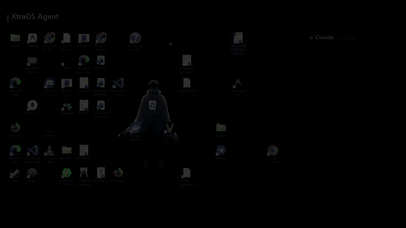

# XtraOS Agent

**LLMs have a brain. XtraOS gives them a body.**

A local MCP server that lets Claude, or any AI agent, see and operate your Windows PC: read
any app, click, type, drag, open and arrange windows, find files. It is fast, works beside you
instead of taking over your mouse, and its safety rules live in the runtime, not in a prompt.



*Three plain-English requests, done through XtraOS: tidy the desktop into a circle, open two
profiles side by side, find the latest resume. The panel on the right shows the actual XtraOS
calls.*

## Why it is different

- **Reads apps, not pixels.** XtraOS uses Windows UI Automation: names, roles, states and exact
  positions of buttons, list rows, files and desktop icons. No screenshot guessing; OCR only
  for apps that draw their own pixels (games, canvas).
- **Fast and token-light.** Reading a window takes ~37 ms, a background click ~7 ms
  ([bench](docs/bench/release-0.1.md)). A routine task takes 3 calls and ~340 result tokens.
- **Works beside you.** Many actions go straight to the control in the background (no cursor,
  no focus change). Real mouse and keyboard input waits until you are idle and stops the
  moment you move the mouse, cancelling a drag instead of dropping it somewhere random.
- **Safety is built in.** Sending messages, deleting files, changing settings and admin apps
  need your OK in a dialog only you can click. It never buys anything or types passwords.
  It refuses to drop one item onto another (a folder, the Recycle Bin).
  **Ctrl+Alt+Esc** halts everything within ~15 ms, and only you can resume.
- **Local and private.** No cloud, no LLM inside, nothing leaves your PC. The action log is
  tamper-evident (hash chain).

## Quick start

**Needs:** 64-bit Windows 10 2004+ or Windows 11. This preview is not code-signed yet, so
Windows' *Smart App Control* must be off.

Once a release is published: `npx xtraos-install` (downloads the release from GitHub, checks
its SHA-256, installs per user). Until then, build it once with [Rust](https://rustup.rs) (the
pinned toolchain installs itself), the Visual Studio C++ Build Tools and Node.js 24. The built
bundle carries its own Node.js.

1. Build the bundle:
   ```powershell
   git clone https://github.com/om0852/XtraOS-Agent; cd XtraOS-Agent
   cd mcp; npm ci; cd ..
   powershell -ExecutionPolicy Bypass -File release/build-release.ps1
   ```
   → `dist\xtraos-0.1.1-win-x64\` (plus a zip and `SHA256SUMS.txt`).
2. Install it (per user, no admin rights):
   ```powershell
   cd dist\xtraos-0.1.1-win-x64
   powershell -ExecutionPolicy Bypass -File install.ps1
   ```
   Then connect your AI tools. `xtraos setup` shows the entry it would add for each client
   it finds (Claude Code, Claude Desktop, Cursor, VS Code, Windsurf, Cline, Codex CLI,
   Gemini CLI, Hermes Agent) and changes nothing until you add `--apply`; each config is backed up first:
   ```powershell
   $x = "$env:LOCALAPPDATA\Programs\XtraOS\xtraos.cmd"
   & $x setup            # dry run: shows what it would change
   & $x setup --apply    # writes it (add --tools core for a smaller tool list)
   & $x doctor           # checks the install and each client
   ```
   The config formats are covered by automated tests; a recorded live run per client is
   still open.
3. Ask your agent something:
   - *"My desktop is a mess. Arrange the icons in a circle."*
   - *"Open my GitHub and LinkedIn side by side."*
   - *"Find my latest resume and show it in Explorer."*
   - *"Calculate 7 + 5 in Calculator and tell me the result."*

The core starts on first use (tray icon). No MCP client? Any agent with a shell can use the
command-line bridge:

```powershell
$x = "$env:LOCALAPPDATA\Programs\XtraOS\bin\xtraos-core.exe"
'{"window":"desktop","bounds":true}' | & $x call observe -
'{"name":"files.find","args":{"path":"C:/Users/me","pattern":"*resume*"}}' | & $x call run_skill -
```
(`-` reads the JSON from stdin, which avoids shell quoting problems.) Skill-based agents
(OpenClaw, Hermes, Claude Code skills) can install [`skills/xtraos/SKILL.md`](skills/xtraos/SKILL.md),
which teaches this bridge. Which AI tools are verified, and how to connect each:
[docs/10-integration-guide.md](docs/10-integration-guide.md).

Uninstall: `%LOCALAPPDATA%\Programs\XtraOS\uninstall.ps1` (`-Purge` also removes its data).

## What it can do

| Area | Tools |
|---|---|
| See | `observe` (element tree with refs, diffs, positions), `find` (incl. virtualised list rows), `read_text`, `screenshot`, `ocr`, `frame_diff`, `wait_for` |
| Act | `click`, `type`, `press_keys`, `scroll`, `drag`, `mouse`, `set_value`, `clipboard`, `touch`, `pen`, `batch` (up to 50 steps in one call) |
| Windows and apps | `list_windows`, `focus_window`, `launch_app`, `close_window`, `window_bounds`, `cleanup`, `app_map`; skills `layout.save/restore` (window arrangements), `window.snap`, `screen.find` (all windows), `disk.usage` |
| Files and routines | skills: `files.list/find/open/mkdir/copy/move/rename/delete`, `files.duplicates/largest/organize/bulk_rename`, macro skills, `record_session` → replayable skill, `routine.*` (a skill on a schedule, once, or per new file; you approve each routine), reminders (`notify.show` + `once_at`), `task.*` checkpoints |
| Office | `office.excel_read/excel_write`, `office.word_read/word_append`, `office.ppt_read/ppt_add_slide`, `office.export_pdf` (hidden Office, macros off) |
| Several agents | per-window locks, per-agent permissions (`policy.json` `clients`), tray → Agents to pause one agent, live "Agents now" view |
| Human in the loop | `ask_human`, `wait_for_human`, approval dialogs, kill switch, `status` |
| More | `sandbox` (a disposable Windows Sandbox desktop), `elevated_helper` (admin apps via UAC), `browser` (via the XtraDevPilot extension), `system`, `volume`, `audit_export` |

Small context window? Set the environment variable `XTRAOS_TOOLS=core` for the MCP server: it
lists 15 everyday tools (~3,400 tokens instead of ~8,500); the rest stay callable.

The full contract is in [docs/04-mcp-tool-contract.md](docs/04-mcp-tool-contract.md). SDKs:
[`sdk/node`](sdk/node) and [`sdk/python`](sdk/python).

## How it works

```
AI agent (Claude Code, Claude Desktop, any MCP client)
   │  MCP (stdio)
   ▼
xtraos-mcp  ── thin translator (TypeScript)
   │  named pipe, current user only, 256-bit pairing token
   ▼
xtraos-core.exe (Rust) ── UI Automation · input · OCR · policy engine · action log · kill switch
   ▼
Your Windows desktop
```

Design and security: [architecture](docs/02-architecture.md),
[security model](docs/05-security-model.md), [decision records](docs/adr/).

## Status

Release 0.1 is an **unsigned developer preview** for Windows. Every capability below is
marked by how it was verified; recorded end-to-end runs are in [docs/flows](docs/flows/README.md).
Not done yet: code signing, macOS and Linux.

<details>
<summary>Capabilities and how each was verified</summary>

| Capability | Status |
|---|---|
| Secure local core ↔ MCP connection (user-only pipe, pairing token, reconnect) | verified — M1 gate (ADR 0009) |
| Action log (no secrets); tamper-evident hash chain (`xtraos-core --verify-log`); max-actions-per-task guard | verified — M1 gate, LG-01, TL-01 (ADR 0038) |
| Real mouse input: click (1–3, any button, modifiers), scroll, drag-and-drop, paths | verified — M2 gate (ADR 0011) |
| Real keyboard input: unicode typing (incl. Hindi, emoji), key chords; `focus: true` brings the window forward first | verified — M2 gate, IN-09b (ADR 0043) |
| Safety guards: user activity → abort, wrong window → refuse, no stuck keys/buttons; an aborted drag is cancelled; no drop onto another item (`TARGET_OCCUPIED`) | verified — M2 gate, DG-01 (ADR 0043) |
| Window control: list, focus, launch (incl. admin via UAC), graceful close, move/resize/min/max | verified — M3 gate (ADR 0013) |
| Elevation boundary: admin windows refused untouched (`ELEVATION_REQUIRED`) | verified — M3 gate |
| Reading windows: `observe` (refs, diffs, `bounds`), `find`, `read_text`; passwords always masked; the desktop icon view (`window: "desktop"`) | verified — M4 gate (ADR 0016), live demo (ADR 0043) |
| Background actions without the user's mouse/keyboard: `click(ref)`, `set_value`, `scroll(ref)` | verified — M4 gate |
| Kill switch: Ctrl+Alt+Esc or tray Stop halts input (15 ms measured), only the user resumes | verified — M5 gate (ADR 0018) |
| Policy engine: send/reply, delete, settings, admin launch need your OK; buying and password entry always blocked; password managers off limits; editable `policy.json` | verified — M5 gate |
| Overlay banner while the agent acts; the agent can never use XtraOS's own windows | verified — M5 gate |
| One-zip per-user install, MCP starts the core on demand, clean uninstall | verified — M6 gate (ADR 0020) |
| `wait_for`, `batch` (each step policy-checked), `observe(scope_ref)`; routine task in ≤ 3 calls / ≤ 2,000 tokens | verified — P2-M1 gate (ADR 0023) |
| `ocr` for opaque windows (games, canvas), offline (~54 tokens vs ~2,225 for a screenshot) | verified — P2-M2 gate (ADR 0025) |
| Locked screen / UAC prompt detected: `NEEDS_HUMAN` instead of acting blind | verified — P2-M2 gate |
| App map (installed apps, encrypted remembered services) and skills (file skills, macro skills); `files.find` newest first | verified — P2-M3 gate (ADR 0027), unit test (ADR 0043) |
| `whatsapp.send` skill: text or file to a number after your OK; checks the chat is that number | verified — P2-M4 e2e, owner's own chat (ADR 0029) |
| Resource discipline: reuses its own windows, `cleanup` closes only those; closing yours asks first | verified — P2-M4 e2e (ADR 0029) |
| Long and virtualised lists: off-screen rows found, `find deep`, a row click selects (never opens) | verified — P2-M7 tests (ADR 0035) |
| Safety words in Hindi, Marathi, Spanish, French, German, Portuguese; read-only rules and activity viewer; rules editor (still asks before applying) | verified — unit, viewer, P2-ED tests (ADR 0035, 0037) |
| `frame_diff`, `record_session` (replayable skills with locators; passwords never recorded) | verified — P3-FD, P3-RR tests |
| `sandbox`: a disposable Windows Sandbox desktop with its own XtraOS (network off by default) | verified live on the owner's PC (ADR 0040) |
| Command-line bridge `xtraos-core call`; `volume`, media keys, `system` (battery, brightness, Wi-Fi/Bluetooth, lock, sleep; switching asks first) | verified live (ADR 0039) |
| SDKs (`@xtraos/sdk`, `xtraos`), `audit_export` (CSV/JSON + chain head hash) | verified — SDK-N1, SDK-P1, AX-01 (ADR 0042) |
| Web pages via the XtraDevPilot bridge (`browser`), same policy | automated tests pass (fake bridge, ADR 0033); live check pending |
| `touch` / `pen` | gesture policy verified; real input verified in the Phase 3 gate |
| Admin windows via the opt-in `elevated_helper` (UAC, accepts only the core, asks per window) | automated tests pass (ADR 0031); human UAC run pending |
| Code-signed binaries (Smart App Control on) | not yet (ADR 0019) |
| Fast observe on windows with thousands of list items | budget missed (167–328 ms vs 120; ADR 0035); use `scope_ref` or `find` |

Gates: `tests/phase0/run-tests.ps1`, `tests/phase1/m1-gate.ps1` … `m6-gate.ps1`,
`tests/phase2/p2m1-gate.ps1` … `p2m7-gate.ps1`, `tests/phase3/p3-gate.ps1`
(`-Interactive` moves the mouse and types; keep hands off).
</details>

## Documents

| Doc | Purpose |
|---|---|
| [docs/01-product-spec.md](docs/01-product-spec.md) | What we build and what we never build |
| [docs/02-architecture.md](docs/02-architecture.md) | Components, IPC, pipelines, repo layout |
| [docs/03-functional-flows.md](docs/03-functional-flows.md) | Step-by-step flows (browser, admin, WhatsApp, games, kill switch) |
| [docs/04-mcp-tool-contract.md](docs/04-mcp-tool-contract.md) | The public MCP tool surface |
| [docs/05-security-model.md](docs/05-security-model.md) | Threats, policy engine, hard boundaries |
| [docs/06-performance-budget.md](docs/06-performance-budget.md) | Token and latency budgets |
| [docs/07-development-plan.md](docs/07-development-plan.md) | Phases, milestones, exit criteria |
| [docs/08-test-plan.md](docs/08-test-plan.md) | Test levels, test cases per phase, phase gates |
| [docs/09-next-phases-plan.md](docs/09-next-phases-plan.md) | Phases 5–8: connect anywhere, reliability, everyday packs, several agents |
| [docs/10-integration-guide.md](docs/10-integration-guide.md) | Connect each AI tool; which ones are verified |
| [CLAUDE.md](CLAUDE.md) | Development rules, boundaries, definition of done |

## Contributing

Issues and pull requests are welcome. Please read [CLAUDE.md](CLAUDE.md) (rules and definition
of done) and the [test plan](docs/08-test-plan.md) first; new behaviour needs a test, and
safety changes need an ADR.

## License

See [LICENSE](LICENSE).
