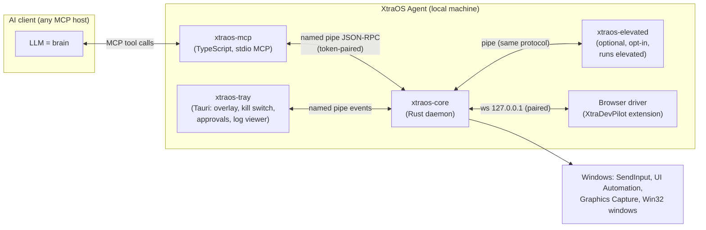
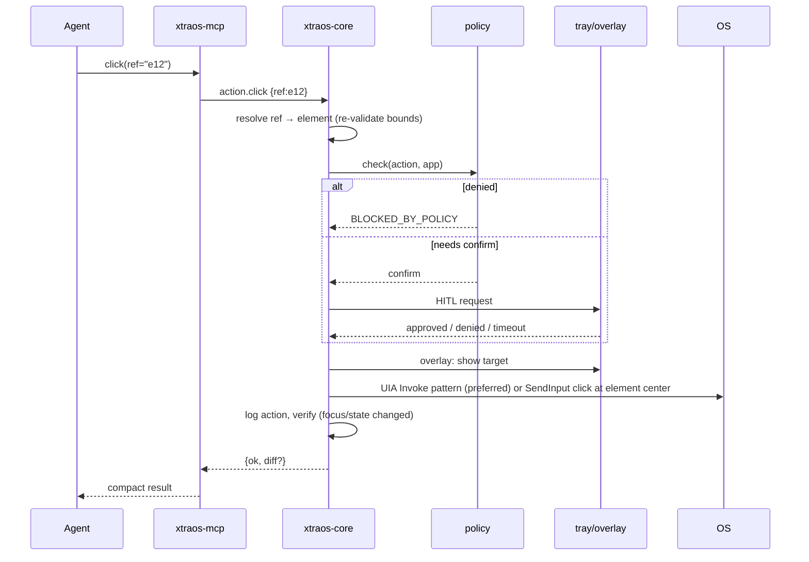

# 02 — Architecture & System Design

## 1. Big picture



**Rule:** only `xtraos-core` (and `xtraos-elevated`) call OS APIs. The MCP server is a thin,
stateless translator. The tray app is the human's control surface.

## 2. Components

### 2.1 xtraos-core (Rust)

| Module | Responsibility |
|---|---|
| `ipc` | Named pipe server `\\.\pipe\xtraos-core-<user-sid>`; ACL = current user only; token handshake; JSON-RPC 2.0 framing. |
| `platform` | `Platform` trait. Phase 1 implements `windows` only. |
| `input` | Mouse/keyboard via `SendInput` (absolute coordinates over the virtual desktop), key chords, text (Unicode `KEYEVENTF_UNICODE`), drag paths, scroll. |
| `perceive` | UI Automation tree walker (cached, depth-limited, control-view), element refs, diffs; screenshots via Windows.Graphics.Capture (fallback: GDI BitBlt); OCR (Phase 2, Windows.Media.Ocr). |
| `windows` | Enumerate/focus/move/close windows, launch apps, process info, foreground tracking. |
| `refs` | Stable element reference table (`e12` → UIA RuntimeId + window + bounds), invalidated on change. |
| `policy` | Allow/deny/confirm rules per app, per action class; sensitive-field detection. |
| `hitl` | Human-in-the-loop requests: emits to tray, waits for approve/deny/timeout. |
| `killswitch` | Global hotkey (default Ctrl+Alt+Esc) + tray button; cancels queue, releases held keys/buttons. |
| `log` | Append-only action log (JSONL) with masking; per-session files. |
| `appmap` | Local encrypted (DPAPI) profile: installed apps, where services are logged in (desktop vs browser profile), paths. Phase 2. |
| `skills` | Deterministic multi-step routines (`app.action(args)`), versioned, declared in YAML + Rust executors. Phase 2. |
| `metrics` | Latency/size counters for budgets. |

### 2.2 xtraos-mcp (TypeScript)

- Exposes the tool surface in `04-mcp-tool-contract.md` over stdio using `@modelcontextprotocol/sdk`.
- Validates input schemas, maps tool calls to core JSON-RPC methods, maps core errors to the
  shared error codes with `hint` fields.
- Shapes outputs for token efficiency (compact text trees, no pretty-printed JSON).
- Holds **no** OS logic and **no** state except the pipe connection.

### 2.3 xtraos-tray (Phase 1: native UI inside the core, ADR 0017; Tauri app later)

- System tray icon + status (Idle / Running / Waiting for you / Stopped).
- **Overlay**: transparent, top-most, click-through window showing the cursor target and a
  keystroke HUD while automation runs. Always visible during actions.
- **Approval dialog** for HITL requests (shows: action, target app, reason, Approve/Deny).
- Settings: policies, hotkey, paired clients, elevated helper install/uninstall.
- Activity log viewer.

### 2.4 xtraos-elevated (optional, Phase 2)

- Same binary/protocol as core's input+windows modules, launched via ShellExecute "runas" so
  the **user approves UAC once**. Needed because UIPI blocks a normal-integrity process from
  sending input to elevated windows.
- Core routes actions targeting elevated windows to this helper; otherwise returns
  `ELEVATION_REQUIRED`.

### 2.5 Browser driver

- Re-uses XtraDevPilot (extension + its bridge). Core connects as a paired client.
- Used when DOM-level precision is better than UIA (web apps). Browsers without the extension
  (e.g. Firefox) are driven through the desktop driver (UIA exposes Firefox/Chrome accessibility).

## 3. Key design decisions

| # | Decision | Why |
|---|---|---|
| D1 | Accessibility tree first, pixels second | 5–10× fewer tokens, stable targets, no DPI math for the agent. |
| D2 | Element refs (`e12`) instead of coordinates in the API | Removes mis-clicks from scaling; cheaper prompts. |
| D3 | Core in Rust, MCP in TypeScript | Rust: safe native OS access + speed. TS: fastest MCP iteration, reuse of XtraDevPilot know-how. |
| D4 | Named pipe with user-only ACL + token | Local-only, not reachable by web pages or the LAN (lesson from the XtraDevPilot bridge fix). |
| D5 | Skills as the cost lever | One tool call executes many deterministic steps; AI only plans. |
| D6 | Human approval is a first-class tool result (`NEEDS_HUMAN`) | Safety + makes UAC/credential boundaries explicit to the agent. |
| D7 | Windows first | Owner's platform; UIA is the richest desktop accessibility API. |

## 4. Data model (core)

```text
Session      { id, client_name, started_at, policy_profile }
Window       { hwnd, pid, process_name, title, bounds, monitor, elevated: bool, focused: bool }
Element      { ref: "e12", role, name, value?, bounds, enabled, focusable, patterns[] , window_ref }
Observation  { window, elements[] | diff, screenshot_id?, truncated: bool, token_estimate }
Action       { id, kind, target(ref|point|window), params, policy_decision, result, duration_ms }
HitlRequest  { id, kind(confirm|elevate|credential|captcha|other), message, status }
AppMapEntry  { service: "whatsapp", surface: desktop|browser, location: path|browser_profile+url }
```

## 5. Perception pipeline (token-efficient)

1. Agent calls `observe(window?)`.
2. Core walks UIA **control view** of the target window, depth ≤ 12, skips offscreen/invisible,
   collapses single-child containers, keeps interactive roles + named text.
3. Assigns refs, renders compact lines: `e12 Button "Send"` / `e7 Edit "Search" = "hello"`.
4. Caps at budget (default 120 elements); marks `truncated` and offers `observe(scope=ref)`.
5. Subsequent `observe` returns a **diff** (added/removed/changed) unless `full=true`.
6. If the tree is empty/opaque (canvas, games): returns `{"opaque": true}` → agent may call
   `screenshot(region, scale)`; Phase 2 adds local OCR text boxes instead of images.

## 6. Action pipeline



Preferred execution order for an element action: **UIA pattern** (Invoke/Toggle/Value/
SelectionItem/ExpandCollapse) → **real input at element centre** → error with hint.

## 7. Repository layout

```text
xtraos-agent/
  CLAUDE.md                 # rules
  docs/                     # spec, architecture, contract, plans, ADRs
  core/                     # Rust workspace: xtraos-core, xtraos-elevated, platform crates
  mcp/                      # TypeScript MCP server (bundled to one file for releases)
  testbed/                  # WinForms test app with known controls
  spikes/                   # throwaway experiments (results go to ADRs)
  tests/                    # gates (phase0, phase1), flows recorder, bench
  release/                  # build/sign/package, install/uninstall, install test (ADR 0019)
  dist/                     # build output (ignored)
```
Phase 1 has no separate tray app: the tray, overlay and dialogs live in the core (ADR 0017).

## 8. Tech stack (pin exact versions when added)

| Area | Choice |
|---|---|
| Core | Rust stable; `windows` crate (Win32 + WinRT: SendInput, UIA COM, Graphics.Capture, DPAPI, OCR) |
| IPC | Named pipes (tokio) + JSON-RPC 2.0 |
| MCP | Node LTS + `@modelcontextprotocol/sdk` |
| Tray | Tauri 2 |
| Tests | Rust `cargo test`; Node test runner; e2e harness driving `testbed/` |
| Packaging | MSI/MSIX (Phase 2), code signing before public release |

Version numbers and crate choices are confirmed in Phase 0 spikes and recorded in ADRs.
